# 🌐 Laboratorio de Redes - Guía de Configuración y Evidencias

Este repositorio contiene la documentación, los pasos detallados y las capturas de pantalla del laboratorio de redes realizado.

---

## 🛠️ Pasos del Laboratorio y Evidencias

### Paso 1: Diseño de la Topología Física
Se realizó el despliegue lógico y físico de los routers, switches y dispositivos finales.
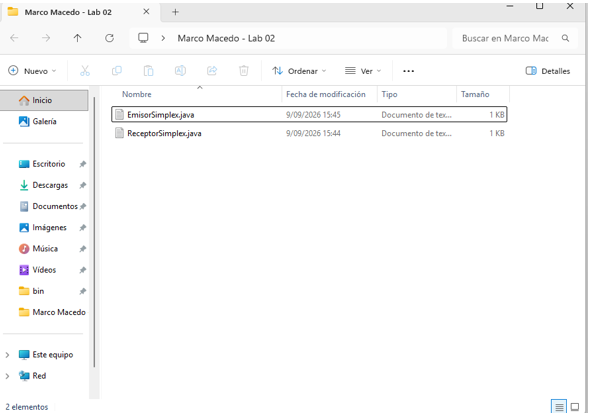

### Paso 2: Configuración Básica de Dispositivos
Se ingresó a la CLI de cada router y switch para asignar el nombre de host y contraseñas.
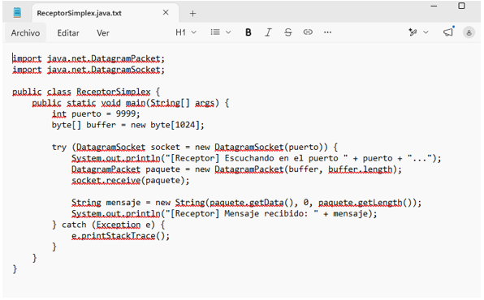

### Paso 3: Asignación y Configuración del Direccionamiento IP
Configuración de las direcciones IP, máscaras de subred y gateways en las interfaces.
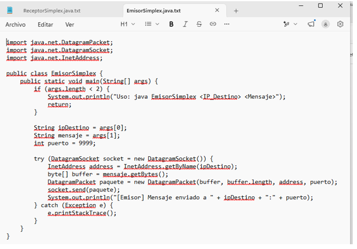

### Paso 4: Creación y Asignación de VLANs
Se configuraron las VLANs requeridas en los switches de distribución y acceso.
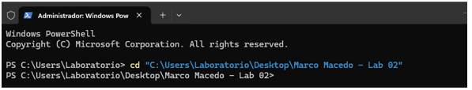

### Paso 5: Configuración de Enlaces Troncales (Trunking)
Activación del protocolo del encapsulamiento IEEE 802.1Q en los enlaces de los switches.
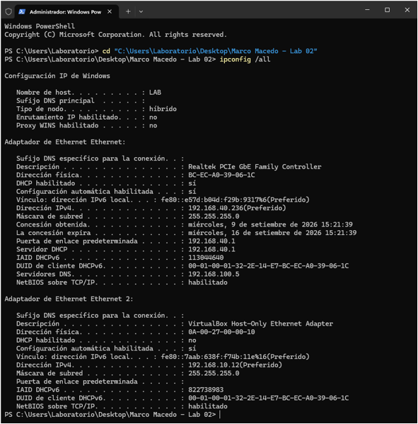

### Paso 6: Enrutamiento Inter-VLAN
Creación y configuración de subinterfaces en el router principal (Router-on-a-stick).
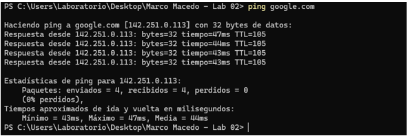

### Paso 7: Implementación del Protocolo de Enrutamiento Dinámico
Configuración de las áreas de enrutamiento dinámico para garantizar la convergencia.
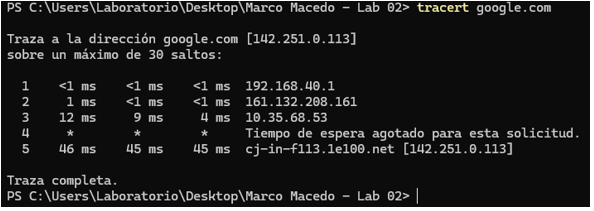

### Paso 8: Configuración de Servidores DHCP
Habilitación de pools de DHCP en el router para la asignación automática de direcciones IP.
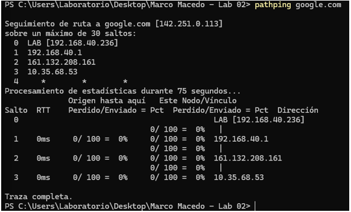

### Paso 9: Configuración de Seguridad y Acceso Remoto (SSH)
Configuración de líneas VTY para permitir la administración segura vía SSH.
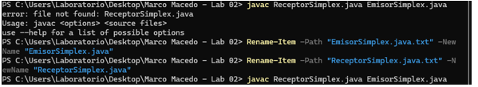

### Paso 10: Implementación de Listas de Control de Acceso (ACLs)
Creación y aplicación de ACLs para filtrar el tráfico de red y restringir accesos.
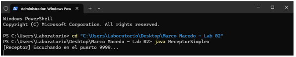

### Paso 11: Pruebas de Conectividad (Ping y Traceroute)
Verificación de la comunicación extremo a extremo mediante el envío de paquetes ICMP.
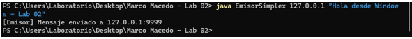

### Paso 12: Verificación de Tablas de Enrutamiento
Inspección final de la tabla de rutas IP en el core de la red.
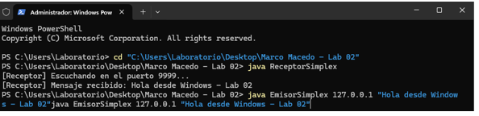
